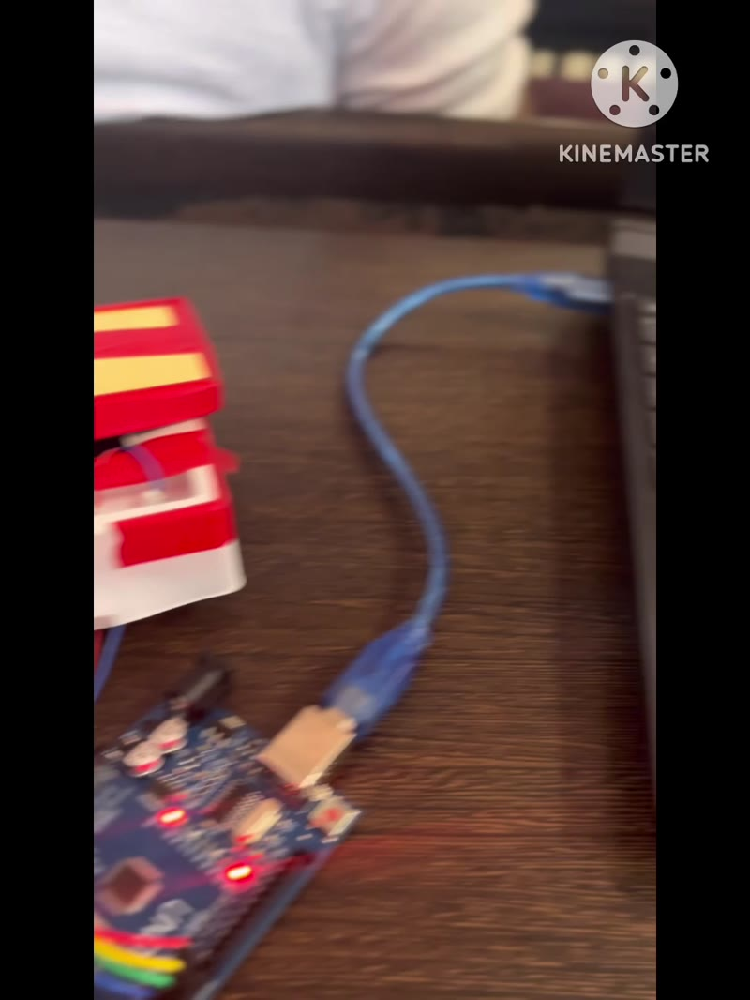

# DIY Colour Spectrophotometer

A low-cost colour spectrophotometer built as a team project (November 2025). The sample sits inside a 3D-printed enclosure. An Arduino takes the light readings and sends them to a laptop over USB.

▶ **[Demo 1](demo-1.mp4)** · **[Demo 2](demo-2.mp4)**
